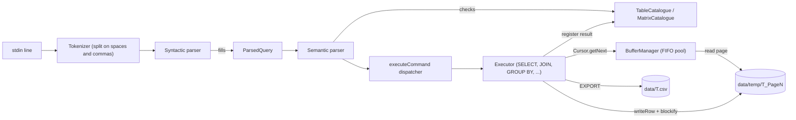

# SQL Database Engine

A disk-backed, integer-only relational query engine in C++ that executes relational-algebra commands over CSV tables using fixed-size pages, a FIFO buffer pool, block nested-loop and partition-hash joins, hash-based `GROUP BY` aggregation, and tiled in-place matrix transposition.


- [Grammar reference](docs/GRAMMAR.md)
- [Architecture deep-dive](docs/ARCHITECTURE.md)
- [Matrix storage design notes](docs/matrix.md)

## Overview

The engine is an interactive REPL (`server`). Each line is a command in a small relational-algebra language, for example:

```
LOAD EMPLOYEE
RICH <- SELECT Salary >= 30000 FROM EMPLOYEE
Q1   <- PROJECT Ssn, Salary FROM RICH
PRINT Q1
```

Tables are loaded from `data/<NAME>.csv`, split into fixed-size page files on disk, and read back one page at a time through a buffer manager, the same way a textbook DBMS stores relations in blocks. Every operator materialises its result as a new paged relation that later commands can query, print, rename or export back to CSV.

The project is built on **SimpleRA**, the teaching skeleton of a Data Systems course (Monsoon 2022, upstream: `github.com/SimpleRA/SimpleRA`). The skeleton provides the page/cursor/buffer-manager scaffolding plus `LOAD`, `PRINT`, `LIST`, `RENAME`, `EXPORT`, `CLEAR`, `CROSS`, `SELECT` and `PROJECT`. This repository adds:

- Block nested-loop join and partition-hash join with a configurable buffer size and block-access accounting
- `GROUP BY` with `MAX` / `MIN` / `SUM` / `AVG`
- A separate matrix subsystem: `LOAD MATRIX`, `PRINT MATRIX`, `EXPORT MATRIX` and an in-place, tile-by-tile `CROSS_TRANSPOSE`

## Key features

- **Paged storage.** Relations are split into page files of `BLOCK_SIZE` (8 KB nominal), each holding `floor(8000 / (4 * columns))` rows.
- **Buffer manager.** A FIFO pool of `BLOCK_COUNT = 2` pages sits between operators and disk; operators only ever see rows through a `Cursor`.
- **Two-phase parsing.** A syntactic pass builds a `ParsedQuery`; a semantic pass validates it against the table catalogue before anything runs.
- **Join algorithms.** Block nested-loop join (`USING NESTED`) and partition-hash join (`USING PARTHASH`), both reporting the estimated number of block accesses for the given buffer size.
- **Aggregation.** Single-column `GROUP BY` with one of `MAX`, `MIN`, `SUM`, `AVG`.
- **Matrices.** Square integer matrices stored as zero-padded 20x20 tiles; `CROSS_TRANSPOSE A B` swaps `A` with the transpose of `B` in place, two tiles at a time.

### Supported SQL subset

The language is relational algebra rather than SQL. The table below maps SQL concepts to the commands that implement them, verified against the parser and executors in `src/`.

| SQL concept | Engine command | Status |
| --- | --- | --- |
| `SELECT * FROM T WHERE a <op> b` / `a <op> 5` | `R <- SELECT a <op> b FROM T` | Implemented. One predicate per command; operators `< > <= >= =< => == !=` |
| `SELECT a, b FROM T` | `R <- PROJECT a, b FROM T` | Implemented. Bag semantics (duplicates kept) |
| `FROM A, B` (Cartesian product) | `R <- CROSS A B` | Implemented. Clashing column names are prefixed with the table name |
| `A JOIN B ON a <op> b` | `R <- JOIN USING NESTED A, B ON a <op> b BUFFER n` | Implemented (block nested-loop) |
| `A JOIN B ON a = b` | `R <- JOIN USING PARTHASH A, B ON a == b BUFFER n` | Implemented (partition hash). Correct for `==` only; see limitations |
| `SELECT g, MAX(x) ... GROUP BY g` | `R <- GROUP BY g FROM T RETURN MAX(x)` | Implemented for `MAX`, `MIN`, `SUM`, `AVG` |
| Column alias (`AS`) | `RENAME a TO b FROM T` | Implemented |
| `SELECT DISTINCT` | `R <- DISTINCT T` | Parsed and validated only, not executed |
| `ORDER BY` | `R <- SORT T BY a IN ASC` | Parsed and validated only, not executed |
| `A JOIN B ON ...` (plain form) | `R <- JOIN A, B ON a == b` | Parsed and validated only, not executed |
| `CREATE INDEX` | `INDEX ON a FROM T USING HASH` | Parsed and validated only, not executed |
| `COUNT`, `HAVING`, `AND`/`OR`, subqueries, `INSERT`/`UPDATE`/`DELETE`, strings, NULLs | none | Not supported |

The full grammar is in [docs/GRAMMAR.md](docs/GRAMMAR.md).

## Architecture



*Figure 1. Query-processing pipeline. A command flows left to right through tokenising, two parsing phases and a single executor; executors read input pages through the buffer manager and write their result as new page files that are registered in the catalogue.*

See [docs/ARCHITECTURE.md](docs/ARCHITECTURE.md) for the component diagram, a sequence diagram of a query, the class diagram and the table lifecycle.

## Tech stack

- C++ (standard library only, no third-party dependencies)
- GNU Make
- g++ (Linux) or Apple Clang via the included `compat/` shim (macOS)

## Project structure

```
.
├── compat/bits/stdc++.h      # Opt-in shim so Clang/libc++ can compile the sources
├── data/                     # CSV tables (and the runtime data/temp/ page directory)
│   ├── EMPLOYEE.csv          # 8 employees: Ssn, Bdate, Sex, Salary, Super_ssn, Dno
│   ├── WORKS_ON.csv          # 16 rows: Essn, Pno, Hours
│   ├── DEPARTMENT.csv        # 3 rows: Dnumber, Mgr_ssn, Mgr_start_date
│   ├── PROJECT.csv           # 6 rows: Pnumber, Dnum
│   ├── A.csv, B.csv          # Small tables used in the examples
│   ├── Q.csv, W.csv          # 10,000 x 6 and 100 x 4 tables for multi-page join tests
│   ├── queries.txt           # Sample relational-algebra workload over EMPLOYEE / WORKS_ON
│   └── a.ra                  # Empty placeholder script for SOURCE
├── docs/
│   ├── ARCHITECTURE.md       # Design deep-dive with diagrams
│   ├── GRAMMAR.md            # Full command grammar
│   ├── matrix.md             # Matrix tiling / transpose design notes (+ images)
│   └── Overview.html         # SimpleRA course slide deck
└── src/
    ├── server.cpp            # REPL loop, tokenizer, global configuration
    ├── syntacticParser.*     # Command dispatch + ParsedQuery definition
    ├── semanticParser.*      # Catalogue-aware validation dispatch
    ├── executor.*            # Execution dispatch + shared helpers
    ├── executors/            # One file per command (parse + validate + execute)
    ├── table.*               # Table: schema, stats, blockify, print, export
    ├── tableCatalogue.*      # Name -> Table* registry
    ├── matrix.*              # Matrix: tiled load/print/export
    ├── matrixCatalogue.*     # Name -> Matrix* registry
    ├── page.*                # In-memory image of one page file
    ├── bufferManager.*       # FIFO page pool, page writes and deletes
    ├── cursor.*              # Row iterator across a table's pages
    ├── logger.*              # Trace log written to ./log
    └── Makefile
```

## Getting started

### Prerequisites

- A C++ compiler: **g++** on Linux / WSL, or **Apple Clang** (Xcode Command Line Tools) on macOS
- `make`

### Build

Linux / WSL (g++ ships `<bits/stdc++.h>`):

```bash
cd src
make
```

macOS (Apple Clang has no `<bits/stdc++.h>`, so point it at the shim):

```bash
cd src
make CXX=clang++ CXXFLAGS="-g -I . -I ../compat"
```

`make clean` removes object files, the `server` binary and the `log` file.

### Run

The engine resolves all paths relative to `src/` (`../data/...`), so always start it from `src/`:

```bash
cd src
./server
```

On start-up it recreates `data/temp/`. Type commands at the `>` prompt; `QUIT` (or end of input) exits and deletes every temporary page file. Anything not `EXPORT`ed is lost.

Commands can also be piped in:

```bash
cd src
./server <<'EOF'
LOAD EMPLOYEE
G <- GROUP BY Dno FROM EMPLOYEE RETURN AVG(Salary)
PRINT G
QUIT
EOF
```

### Data format

- A table is a file `data/<NAME>.csv`. The first line is the header of column names (whitespace is stripped; names must be unique).
- Every following line is a row of **integers**, one per column, comma-separated. Every cell must have a value.
- There is no separate schema or metadata file. The schema is inferred from the header, and per-table metadata (column list, row count, block count, rows per block, distinct-value counts) lives only in memory in the `Table` object.
- A matrix is a headerless `data/<NAME>.csv` of an N x N grid of comma-separated values.

## Usage

All outputs below were produced by building and running the engine against the sample data in `data/`. `GROUP BY` uses a hash map, so its row order may differ between platforms.

| Command(s) | Output |
| --- | --- |
| `LOAD EMPLOYEE` | `Loaded Table. Column Count: 6 Row Count: 8` |
| `LOAD WORKS_ON` | `Loaded Table. Column Count: 3 Row Count: 16` |
| `RICH <- SELECT Salary >= 30000 FROM EMPLOYEE`<br>`Q1 <- PROJECT Ssn, Salary FROM RICH`<br>`PRINT Q1` | `Ssn, Salary` / `4, 30000` / `5, 38000` / `6, 40000` / `7, 43000` / `8, 55000` (Row Count: 5) |
| `RENAME Salary TO Pay FROM Q1`<br>`PRINT Q1` | Header becomes `Ssn, Pay`; rows unchanged |
| `LOAD B`<br>`XX <- CROSS B B` | Columns `B1_a, B1_b, B2_a, B2_b`, 16 rows |
| `LOAD A`<br>`E <- SELECT a > 100 FROM A` | `Empty Table` (no relation is created) |
| `NJ <- JOIN USING NESTED EMPLOYEE, WORKS_ON ON Ssn == Essn BUFFER 3` | `Total number of block accesses are 3`; `NJ` has 9 columns, 16 rows |
| `HJ <- JOIN USING PARTHASH EMPLOYEE, WORKS_ON ON Ssn == Essn BUFFER 4` | `Total number of block accesses are 12`; same 16 rows, grouped by bucket |
| `G1 <- GROUP BY Dno FROM EMPLOYEE RETURN MAX(Salary)` | `Dno, MAXSalary` / `1, 55000` / `5, 40000` / `4, 43000` |
| `G2 <- GROUP BY Dno FROM EMPLOYEE RETURN AVG(Salary)` | `Dno, AVGSalary` / `1, 55000` / `5, 33250` / `4, 31000` |
| `G3 <- GROUP BY Pno FROM WORKS_ON RETURN SUM(Hours)` | `Pno, SUMHours` / `30, 55` / `20, 25` / `10, 55` / `3, 50` / `2, 37` / `1, 52` |
| `LOAD Q`<br>`LOAD W`<br>`J <- JOIN USING NESTED Q, W ON pk == pk2 BUFFER 3` | `Loaded Table. Column Count: 6 Row Count: 10000`, then `Total number of block accesses are 560` |
| `H <- JOIN USING PARTHASH Q, W ON pk == pk2 BUFFER 3` | `Total number of block accesses are 594` |
| `X <- JOIN USING NESTED A, B ON a == a BUFFER 2` | `SEMANTIC ERROR: Buffer Size cannot be less than 3` |
| `LIST TABLES` | `RELATIONS`, one name per line, then `Row Count: <n>` |
| `EXPORT RICH` | Writes `data/RICH.csv` |
| `CLEAR RICH` | Drops `RICH` and deletes its page files |

Matrix example with a 3x3 `data/M1.csv` (`1..9`) and `data/M2.csv` (`10..90`):

```
> LOAD MATRIX M1
Loaded Matrix. 3x3 Matrix
> LOAD MATRIX M2
Loaded Matrix. 3x3 Matrix
> CROSS_TRANSPOSE M1 M2
> PRINT MATRIX M1
10 40 70
20 50 80
30 60 90
> PRINT MATRIX M2
1 4 7
2 5 8
3 6 9
```

`data/queries.txt` contains a longer workload (four multi-step queries over `EMPLOYEE` and `WORKS_ON` built from `CROSS`, `SELECT`, `PROJECT` and `RENAME`); paste it into the REPL or pipe it in with `./server < ../data/queries.txt`. Note that its final `EXPORT` lines write `Q1.csv` ... `Q4.csv` into `data/`.

## Testing

There is no automated test suite. The engine was verified manually by building it and piping the commands in the Usage table into `./server`; the outputs shown above are the observed results. `PRINT` on any relation is the quickest way to inspect intermediate results, and `src/log` records a trace of every function call for the last session.

## How it works

**Tokenising and parsing.** `server.cpp` reads one line, splits it with the regex `[^\s,]+` and hands the tokens to `syntacticParse()`, which dispatches on the first (or third, for `R <- ...` assignments) token to a per-command parser that fills fields of the global `ParsedQuery`. `semanticParse()` then checks the request against the catalogue: input relations and columns must exist, the result relation must not, buffer sizes must be at least 3. Only if both phases pass does `executeCommand()` run the operator.

**Storage.** `LOAD T` reads `data/T.csv`, records column names, and `blockify()` streams the rows into page files `data/temp/T_Page0`, `T_Page1`, ... Each page is a text file with one space-separated row per line and holds `floor(BLOCK_SIZE * 1000 / (sizeof(int) * columns))` rows, so `EMPLOYEE` (6 columns) fits 333 rows per page and the 10,000-row `Q` occupies 31 pages. While blockifying, the table counts rows and distinct values per column.

**Buffer manager and cursors.** Operators never open page files directly. A `Cursor` asks the `BufferManager` for page *k* of a table; the manager returns it from a `deque` pool if present, otherwise constructs a `Page` from disk and evicts the oldest page once `BLOCK_COUNT` pages are resident (FIFO). `Cursor::getNext()` walks rows and moves to the next page transparently.

**Execution model.** Every operator is fully materialised: it scans its inputs through cursors, appends result rows to `data/temp/R.csv`, then calls `blockify()` on the result and registers it in the `TableCatalogue`. Results are therefore first-class relations that later commands can use.

**Block nested-loop join** (`USING NESTED`, `src/executors/nested_join.cpp`). With `B` buffer pages, the outer relation is read in chunks of `(B - 2)` pages' worth of rows. For each chunk the inner relation is scanned one page at a time and every pair is tested with the join operator, so any of the six comparison operators works. The engine prints the analytic cost `b(R) + b(S) * ceil(b(R) / (B - 2)) + b(result)`.

**Partition-hash join** (`USING PARTHASH`, `src/executors/parthash_join.cpp`). Both inputs are partitioned into `B - 1` bucket relations by `value % (B - 1)` on the join column, each bucket written out as its own paged temporary table. Matching bucket pairs are then joined with a nested loop, and the bucket tables are dropped. The printed cost is `b(R) + b(S) + b(result) + Σ (b(Rᵢ) + b(Sᵢ) + b(Rᵢ) * b(Sᵢ))`.

**GROUP BY** (`src/executors/group_by.cpp`). A single scan builds an `unordered_map<group value, running aggregate>` (plus a count map for `AVG`). The map is then written out as a two-column relation named `<group col>, <AGG><agg col>`.

**Matrix tiling and `CROSS_TRANSPOSE`** (`src/matrix.cpp`, `src/executors/cross_transpose.cpp`). `LOAD MATRIX M` cuts an N x N matrix into 20x20 tiles stored as `data/temp/M_<i>_<j>`, zero-padding the last tile row and column. `CROSS_TRANSPOSE A B` visits every tile pair `(A[i][j], B[j][i])`, loads just those two tiles, swaps `A[r][c]` with `B[c][r]` element by element and writes both back, so afterwards `A = Bᵀ` and `B = Aᵀ` with only two tiles in memory at a time. `EXPORT MATRIX` stitches the tiles back into `data/M.csv`, dropping the padding.

## Limitations and future work

- **Integers only.** Every table cell is parsed with `stoi`; there are no strings, floats, dates or NULLs. `AVG` is computed as a float but truncated to an integer when the result relation is paged.
- **Stub operators.** The plain `JOIN ... ON`, `DISTINCT`, `SORT` (so no external sort), `INDEX` and `SOURCE` are parsed and validated but do nothing. Implementing external merge sort and `DISTINCT` on top of the existing cursor and page APIs is the natural next step.
- **Partition-hash join semantics.** Rows are bucketed by `value % (B - 1)`, so the join is only complete for `==`; other operators only compare rows that happen to share a bucket. Negative join-key values produce a negative bucket index, which is undefined behaviour.
- **One predicate, one aggregate.** `SELECT` takes a single comparison; `GROUP BY` takes one grouping column and one aggregate; there is no `COUNT`, `HAVING`, `AND`/`OR`, or nesting.
- **In-memory aggregation.** `GROUP BY` keeps all groups in a hash map, so it is not bounded by the buffer pool.
- **Block-access figures are estimates.** The join and group-by counts are computed from block counts, not measured I/O.
- **No persistence of the catalogue.** Results live in `data/temp/` for one session only; `EXPORT` is the only way to keep them. `LIST TABLES` does not list matrices.
- **Working directory.** All paths are relative (`../data`), so the binary must be run from `src/`.
- **Matrix scope.** Matrix values are handled as raw text tokens and tiles are a fixed 20x20. The sparse-matrix layout described in `docs/matrix.md` is a design proposal and is not implemented.

## Author

Kushal Shah — [github.com/Kushal7788](https://github.com/Kushal7788)
