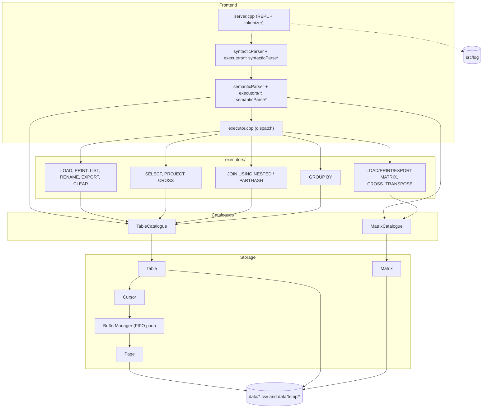
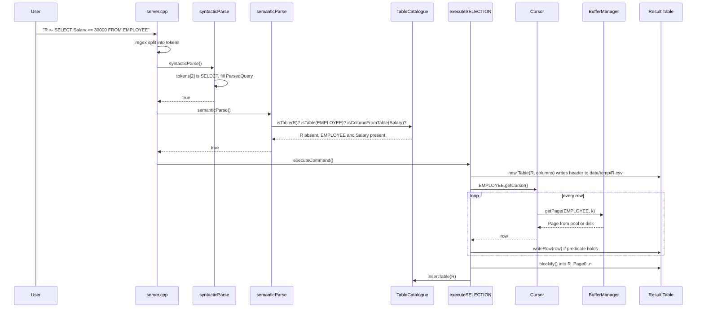
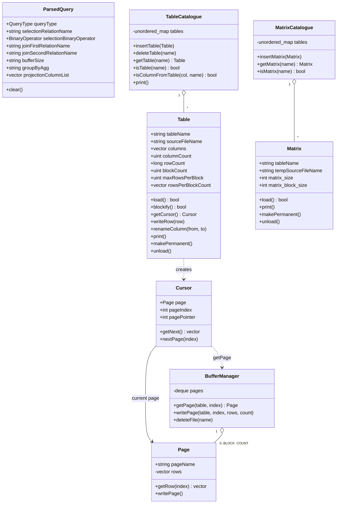
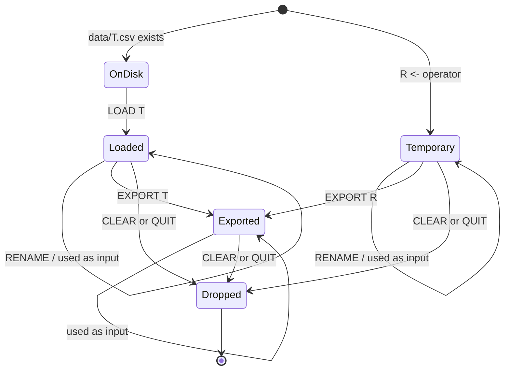
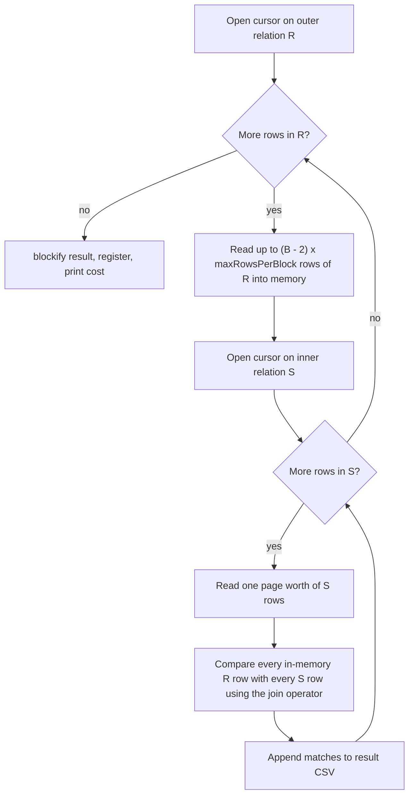
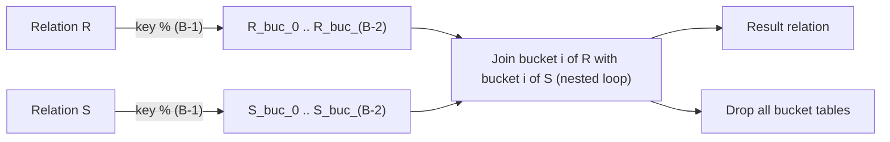

# Architecture

This document describes how the engine is put together: the components and their responsibilities, how a single command travels through them, the main types, the on-disk layout, and the algorithms behind the join, aggregation and matrix operators. Everything here is derived from the sources in `src/`.

## 1. Components

*Figure 1. Component diagram. The front end turns a text line into a validated `ParsedQuery`; operators resolve relations through the catalogues and access data through cursors, the buffer manager and pages. Matrices bypass the page/cursor layer and manage their own tile files.*

The front end is three stages wired together by global state declared in `global.h`: `tokenizedQuery` (the token vector), `parsedQuery` (a single `ParsedQuery` instance that is cleared before each command), and the two catalogues. Every command lives in its own file under `src/executors/` (plus `src/clear.cpp`) and contributes three functions: `syntacticParseX`, `semanticParseX` and `executeX`. Adding a command means adding a `QueryType` value, one dispatch line in each of the three dispatchers, and that file.

The storage layer has a strict layering. Operators read rows only through a `Cursor`; a cursor obtains pages only from the `BufferManager`; only `Page` reads page files. Writes go the other way: operators append rows to a result CSV with `Table::writeRow`, and `Table::blockify` turns that CSV into page files via `BufferManager::writePage`. A `Logger` writes a trace line for nearly every function call to `./log`.

Global tuning constants are defined in `server.cpp`:

| Constant | Value | Meaning |
| --- | --- | --- |
| `BLOCK_SIZE` | `8` | Page size in KB (rows per page = `floor(BLOCK_SIZE * 1000 / (4 * columns))`) |
| `BLOCK_COUNT` | `2` | Pages held by the buffer pool |
| `PRINT_COUNT` | `20` | Maximum rows shown by `PRINT` |

## 2. Lifecycle of a command

*Figure 2. Sequence diagram for a selection. The same shape applies to every assignment operator: parse, validate against the catalogue, scan inputs through cursors, append to a result CSV, blockify, register.*

If either parsing phase fails the command stops with `SYNTAX ERROR` or `SEMANTIC ERROR: ...` and nothing is executed. A selection that matches no rows prints `Empty Table` and the result relation is unloaded instead of registered.

## 3. Main types

*Figure 3. Class diagram. `ParsedQuery` is a flat record with one group of fields per command. A `Table` owns its schema and statistics but not its rows; rows live in page files and are reached through `Cursor` and `BufferManager`. `Matrix` is a parallel type with its own catalogue and its own tiled file format.*

`Page` objects are value types: the buffer manager returns copies, and a `Cursor` holds its own copy of the current page. The pool is a `deque<Page>` searched linearly by page name; on a miss the page is read from disk, pushed to the back, and the front page is dropped once the pool holds `BLOCK_COUNT` pages.

## 4. Storage layout

| Path | Written by | Format |
| --- | --- | --- |
| `data/<T>.csv` | User, or `EXPORT T` | Header line of column names, then comma-separated integer rows |
| `data/temp/<T>.csv` | Every assignment operator | Result rows before paging (header + `, `-separated rows); deleted on `CLEAR`/`QUIT` |
| `data/temp/<T>_Page<k>` | `Table::blockify` via `BufferManager::writePage` | Up to `maxRowsPerBlock` lines, each a row of space-separated integers |
| `data/temp/<T>_buc_<i>.csv`, `<T>_buc_<i>_Page<k>` | Partition-hash join | Temporary bucket relations, dropped when the join finishes |
| `data/<M>.csv` | User, or `EXPORT MATRIX M` | Headerless N x N grid, comma-separated |
| `data/temp/<M>_<i>_<j>` | `Matrix::load` | One 20x20 tile: 20 lines of 20 space-separated values, zero-padded |
| `data/<name>.ra` | User | Script file checked by `SOURCE` (execution is a stub) |
| `src/log` | `Logger` | Function-level trace of the last session |

There is no catalogue file: schema and statistics are reconstructed from the CSV header on every `LOAD` and kept only in memory.

### Relation lifecycle

*Figure 4. State diagram of a relation. Loaded and derived relations both exist as page files in `data/temp/` for the session. `EXPORT` writes a CSV into `data/`, which is the only state that survives `QUIT`; `CLEAR` and `QUIT` delete the page files.*

`RENAME` only changes the in-memory column list; page files hold no header, so nothing on disk is rewritten until an `EXPORT`.

## 5. Operator algorithms

### Selection, projection, cross product

All three are single-pass scans that write one result row per qualifying input row (selection), per input row (projection) or per input pair (cross product, a tuple-at-a-time nested loop that reopens the inner cursor for each outer row). Projection keeps duplicates. For a cross product, columns present in both inputs are prefixed with the table name (`EMPLOYEE_Ssn`); crossing a table with itself prefixes with `<T>1_` and `<T>2_`.

### Block nested-loop join

*Figure 5. Block nested-loop join. `B - 2` buffers hold a chunk of the outer relation, one buffer streams the inner relation, one is reserved for output. Any comparison operator is supported because every pair in the chunk is tested.*

Reported cost: `b(R) + b(S) * ceil(b(R) / (B - 2)) + b(result)`.

### Partition-hash join

*Figure 6. Partition-hash join. Both inputs are partitioned into `B - 1` paged bucket relations by the join key modulo `B - 1`; only matching bucket pairs are compared.*

Reported cost: `b(R) + b(S) + b(result) + Σ_i (b(R_i) + b(S_i) + b(R_i) * b(S_i))`. Because partitioning is by modulo, rows that satisfy a non-equality predicate can land in different buckets, so the result is only complete for `==`.

### GROUP BY

One cursor scan maintains `unordered_map<int, int>` from group key to running `MAX`/`MIN`/`SUM` (and a second count map for `AVG`). The map is then emitted as a two-column relation `<g>, <AGG><x>`. Output order follows the hash map. `AVG` values are written as floats and truncated to integers by `stoi` when the result is paged.

### Matrix tiling and in-place cross transpose

`LOAD MATRIX M` reads `data/M.csv` row by row and appends each 20-value slice to tile `M_<rowBlock>_<colBlock>`, padding the last tile row and column with zeros. `CROSS_TRANSPOSE A B` (matrices of equal size) iterates over every tile coordinate `(i, j)`, loads `A_i_j` and `B_j_i`, swaps `A[r][c]` with `B[c][r]` for every cell, and writes both tiles back. After the pass, `A` holds `Bᵀ` and `B` holds `Aᵀ`, with at most two tiles in memory. `EXPORT MATRIX M` walks the tile grid row by row, seeking to the right line in each tile, and rewrites `data/M.csv` without the padding. See [matrix.md](matrix.md) for the original design notes and figures; the sparse-matrix sections there are a design proposal only.

## 6. Unimplemented operators

`executeJOIN`, `executeDISTINCT`, `executeSORT`, `executeINDEX` and `executeSOURCE` are empty functions. Their parsers and semantic checks are complete, so the grammar accepts them, but they create no relation and print nothing. The existing cursor, `writeRow` and `blockify` primitives are sufficient to add an external merge sort (and from it `SORT`, `DISTINCT` and a sort-merge `JOIN`) without changing the storage layer.
